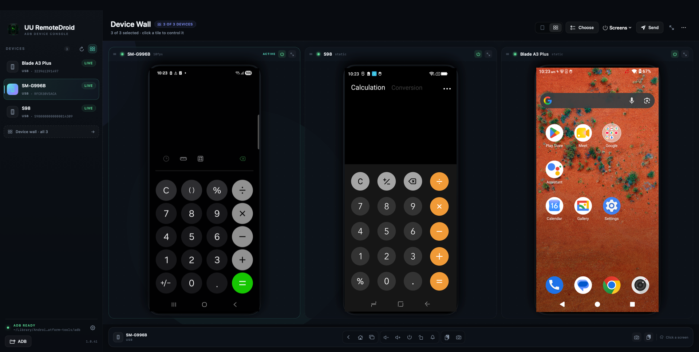
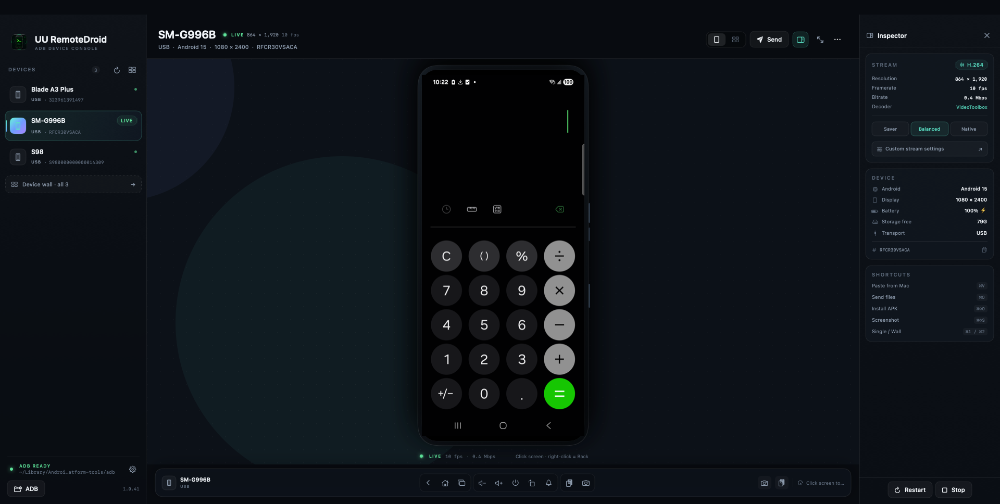

# UU RemoteDroid

A native macOS front end for **scrcpy**, built for phones and emulators that
are connected to this Mac over ADB.

UU RemoteDroid talks to the official `scrcpy-server` directly, decodes the H.264
video with **VideoToolbox**, and injects real mouse, keyboard and touch events
back through scrcpy's control channel. It does not need a separately installed
`scrcpy` app.





*Screenshots are captures of the app window. Each phone screen is filled in with
an `adb screencap` of that phone, because a window capture leaves out the
hardware-decoded video layer.*

## What it does

- Detects USB, Wi-Fi and emulator ADB targets automatically.
- Mirrors several devices at once. Click a device in the sidebar to switch;
  use **Device Wall** (`⌘2`) to see up to six selected screens in a 3 × 2 wall.
- A **Choose** picker controls exactly which devices appear in the wall. The
  selection is remembered between launches; any subset from one to six works.
- Drag a wall tile by its header (grip, name and status) onto another tile to
  reorder the wall. The order is remembered; right-click a tile for
  **Move left** / **Move right**.
- A power button on every wall tile (and in the dock) turns that phone's
  screen on or off; it is green while the screen is on. **Screens** in the
  wall header turns every wall phone on or off at once.
- Streams heal themselves: if the scrcpy server stops, the stream goes silent
  while the phone is awake, ADB stops answering, or the Mac wakes from sleep,
  UU RemoteDroid reconnects that device automatically with a short backoff.
- Hardware-decoded H.264 at 60 fps by default, with optional native resolution,
  Display/120 fps and 8–48 Mbps presets.
- Full mouse control: tap, drag/swipe, scroll, right-click for Back and
  middle-click for Home.
- Real keyboard input, including Unicode text, modifiers, arrows, Enter, Tab,
  Backspace, Escape and media/navigation keys.
- Shared text clipboard: copy on one device and paste on another, or copy on
  the Mac and paste on a device. Device copies also update the Mac clipboard.
- `⌘V` sets the device clipboard and pastes the Mac clipboard into the focused
  Android field.
- Drag files onto the mirror to send them to `/sdcard/Download`.
- Drop an `.apk` (or use **Install APK**) to install it with `adb install -r`.
- In grid mode, drop an `.apk` anywhere on the wall to install it on every
  phone on the wall at once; one toast reports which phones succeeded.
- Device navigation buttons: Back, Home, Recents, volume, power, rotate and
  notification shade.
- Screenshot capture.
- **Logcat**: stream a device's log live in its own window (**Device → Show
  Logcat**, `⌘⇧K`, the **More** menu or a wall tile's right-click menu). Search
  as you type, combine words with `tag:Name`, `pid:123` and `-exclude`, pick a
  minimum level, pause, copy selected lines with `⌘C`, or save what's shown as
  a text file. Scroll up to read back; **Jump to latest** resumes following. It
  keeps the newest 50,000 lines and stops adb when the window closes.
- Session statistics: resolution, live frame rate and bitrate.
- Local-only operation. ADB traffic uses the existing USB/Wi-Fi ADB link and a
  loopback reverse tunnel.
- Inactive sessions stop decoding while their surface is off screen, so keeping
  several devices connected does not accumulate queued video frames. Switching
  back asks the device for a fresh keyframe automatically.

## Requirements

- macOS 14 Sonoma or later.
- Android platform-tools (`adb`). UU RemoteDroid looks in the usual SDK,
  Homebrew and `PATH` locations; you can also choose the executable in
  **Settings → ADB**.
- USB debugging enabled and authorised on each phone, or a running Android
  emulator.
- To build: Xcode 16 or later (Swift 6 compiler, Swift 5 language mode) and the
  bundled `Resources/scrcpy-server-v5.0.1`.

## Install

Download `UU-RemoteDroid-<version>.dmg` from the
[latest release](https://github.com/uulabs/UURemoteDroid_MacOS/releases/latest),
open it, drag **UU RemoteDroid** to **Applications** and launch it from there.
Each release also publishes a `.sha256` file for every asset.

The app is signed by UULabs but not notarised, so the first launch may need
**right-click → Open** (or **System Settings → Privacy & Security → Open
Anyway**).

If you run it directly from a network/external volume, macOS LaunchServices may
refuse to open it. Copy it to Applications (or run the executable in
`UU RemoteDroid.app/Contents/MacOS/`) instead.

## Updates

UU RemoteDroid checks GitHub for a newer release shortly after launch and then
every six hours. When one is available it asks before doing anything; choose
**Install Update**, **Later** or **Skip This Version**. Before installing, the
update is:

- downloaded only over HTTPS from this repository's latest stable release;
- checked against the SHA-256 published beside it;
- checked for the right bundle identifier and version;
- checked for a valid code signature from the UULabs team (`V726L7NR7H`).

The app then quits, swaps itself for the new version and reopens. Your devices,
wall layout and settings are kept. Use **UU RemoteDroid → Check for Updates…**
to check by hand. Turn automatic checks off in the same menu or in
**Settings → Updates**.

## Build from source

```bash
make app          # release app -> dist/UU RemoteDroid.app
make dmg          # dist/UU RemoteDroid.dmg
make release      # signed, verified release ZIP + DMG with .sha256 files
make test         # protocol/parser/geometry/update unit tests
```

`make` uses `.build` by default; set `REMOTEDROID_BUILD_DIR` to build
somewhere else. `scripts/build-app.sh` signs with a Developer ID or Apple
Development certificate when one is installed (override with
`CODESIGN_IDENTITY`), otherwise ad hoc. `make release` refuses to package a
build that is not signed by the UULabs team, because the updater would reject
it. See [RELEASING.md](RELEASING.md) for publishing.

The app icon is generated from `Resources/AppIcon-source.webp` with
`make icon`.

### Integration smoke tests

The deterministic suite is device-free:

```bash
swift test
```

Optional device-backed checks exercise a real push, an APK install, a live
scrcpy session and Home-key injection:

```bash
UU_INTEGRATION=1 \
UU_ADB_PATH="$HOME/Library/Android/sdk/platform-tools/adb" \
UU_ADB_SERIAL=emulator-5554 \
UU_SCRCPY_SERVER="$PWD/Resources/scrcpy-server-v5.0.1" \
UU_INTEGRATION_SCRATCH="$PWD/.build/push-test" \
UU_TEST_APK="/path/to/smoketest.apk" \
swift test --filter IntegrationTests
```

## Using it

1. Connect a phone and approve the **Allow USB debugging** prompt, or start an
   emulator.
2. Pick it in the sidebar. The first stream starts automatically.
3. Click the mirror, then type or use the trackpad/mouse. The bottom dock gives
   you Back/Home/Recents, volume, power, rotate and notifications.
4. Drop files on the mirror. APKs install; everything else lands in the
   device's Download folder.
5. Switch devices in the sidebar. Streams stay live, so switching is instant.
6. Click **Device Wall** in the header (`⌘2`). Use **Choose** to pick exactly
   which phones/emulators appear in the wall. Click any tile to make it active;
   the active device receives the control dock and file drops. Drag the tile
   header (the grip beside the device name) to reorder them; the order persists.
   Right-click a tile to focus it, restart its stream, move it, or hide it.
7. Clipboard sync is on by default. Text copied on any mirrored device updates
   the Mac clipboard and every other live device; text copied on the Mac is
   pushed to all live devices. Turn it off in **Settings → Clipboard**. Only
   text is synchronised — images and files are not.

### Keyboard

| Input | Action |
| --- | --- |
| Printable characters / Unicode | Injected as text |
| Return, Tab, Escape, arrows, Home/End, Page Up/Down, Delete | Android key events |
| `⌘V` | Set the device clipboard from the Mac and paste it |
| `⌘O` | Send files |
| `⌘⇧O` | Install an APK |
| `⌘⇧S` | Screenshot |
| `⌘⇧K` | Show logcat for the selected device |
| `⌘[` | Back |
| `⌘⇧H` | Home |
| `⌘⇧Tab` | Recent apps |
| `⌘1` / `⌘2` | Single device / Device Wall |
| `⌘,` | Settings |

Click a mirror first so UU RemoteDroid owns the keyboard. The dock will show
**Keyboard active**. Right-click on the mirror sends Back; middle-click sends
Home. Scrolling uses Android scroll events at the pointer location.

## How it works

```
macOS app
 ├─ ADB discovery (adb devices -l)
 ├─ ScrcpySession per device
 │   ├─ push scrcpy-server-v5.0.1 -> /data/local/tmp
 │   ├─ adb reverse localabstract:scrcpy_<scid> -> loopback port
 │   ├─ start app_process scrcpy server
 │   ├─ accept video + control sockets
 │   ├─ H.264 demux -> VTDecompression -> AVSampleBufferDisplayLayer
 │   └─ input messages on control socket
 └─ SwiftUI console, wall mode, file/APK transfer
```

- The scrcpy server is bundled, version-locked to the client protocol
  (5.0.1).
- Each device gets a unique 31-bit `scid` and its own loopback reverse tunnel,
  so multiple sessions can run simultaneously.
- No scrcpy binary, Python server or external web server is used at runtime.
- VideoToolbox does hardware decoding. Frames are marked for immediate display
  to keep latency low; frame readiness is treated only as a queue hint because
  the source is real-time.
- Audio is deliberately disabled. It is not required for interaction and
  leaving it out keeps latency and CPU use down.

## Files and paths

- App: `dist/UU RemoteDroid.app`
- DMG: `dist/UU RemoteDroid.dmg`
- Bundled server: `Resources/scrcpy-server-v5.0.1`
- Source: `Sources/RemoteDroidCore` (protocol, ADB, session, video) and
  `Sources/RemoteDroid` (SwiftUI interface)
- Tests: `Tests/RemoteDroidCoreTests`

`dist/`, `.build/` and generated app bundles are intentionally ignored; the
source, icon, bundled scrcpy server and its licence are versioned.

## Limitations and notes

- Only **H.264** video is used. That is the compatible default for all Android
  devices supported by scrcpy; audio, camera and virtual-display modes are out
  of scope.
- Clipboard sync is text-only. It covers Mac ↔ device and device ↔ device while enabled;
  images and file contents are not transferred.
- Moving between single-device mode and the wall keeps a reference on every
  visible video surface, so the outgoing view cannot pause a stream whose
  replacement view is already on screen.
- `adb` is not bundled; Android platform-tools must already be installed.
- Releases are signed but not notarised; see **Install** for the first launch.
- The DMG's app is not sandboxed because it needs to launch `adb` and use local
  sockets.
- If the device drops off while a session is live, the error banner includes the
  last scrcpy server log lines. Retry after reconnecting.
- Entering/exiting native fullscreen triggers an automatic display-layer refresh
  and a fresh keyframe so the fullscreen surface resumes drawing. Keyboard focus
  is returned to the viewer at the same time.
- A stalled stream is detected and reconnected automatically (see above). A
  phone whose screen is off is not treated as stalled. To force it, use the **More** menu → **Refresh video** (or
  right-click a wall tile → **Restart this stream**). These request a new
  encoder config/keyframe without dropping the device session.
- Some Samsung firmware (notably One UI 7 / Android 15) aborts the scrcpy
  server when its `app_process` command line exceeds roughly 255 bytes. The
  server command is intentionally compact (currently 221 bytes at the default
  1080p/60/24 Mbps settings) and a regression test guards that limit.

## Credits and licences

Built for UU Labs.

### scrcpy

Device capture and control are provided by
[scrcpy](https://github.com/Genymobile/scrcpy). UU RemoteDroid bundles the
official, **unmodified** `scrcpy-server` 5.0.1 binary
(`Resources/scrcpy-server-v5.0.1`) and implements its own macOS client for
the scrcpy protocol.

```
Copyright (C) 2018 Genymobile
Copyright (C) 2018-2026 Romain Vimont

Licensed under the Apache License, Version 2.0 (the "License");
you may not use this file except in compliance with the License.
You may obtain a copy of the License at

    http://www.apache.org/licenses/LICENSE-2.0

Unless required by applicable law or agreed to in writing, software
distributed under the License is distributed on an "AS IS" BASIS,
WITHOUT WARRANTIES OR CONDITIONS OF ANY KIND, either express or implied.
See the License for the specific language governing permissions and
limitations under the License.
```

The full Apache License 2.0 text is in
[`Resources/SCRCPY-LICENSE.txt`](Resources/SCRCPY-LICENSE.txt). Every app build
carries it, together with [`THIRD_PARTY_NOTICES.md`](THIRD_PARTY_NOTICES.md),
in `UU RemoteDroid.app/Contents/Resources/`. Both are linked from
**UU RemoteDroid → About UU RemoteDroid** and **Settings → About**.
scrcpy is a project of Genymobile and Romain Vimont; UU RemoteDroid is not
affiliated with or endorsed by them.
