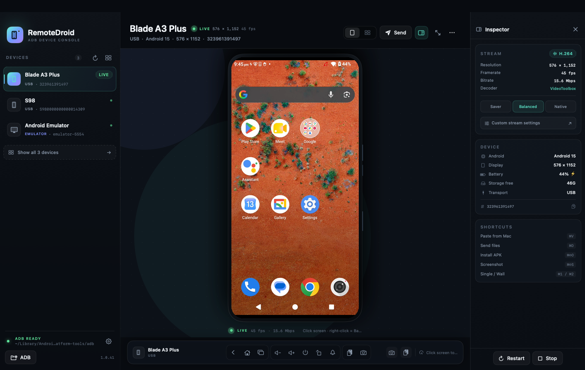

# RemoteDroid

A native macOS front end for **scrcpy**, built for phones and emulators that
are connected to this Mac over ADB.

RemoteDroid talks to the official `scrcpy-server` directly, decodes the H.264
video with **VideoToolbox**, and injects real mouse, keyboard and touch events
back through scrcpy's control channel. It does not need a separately installed
`scrcpy` app.



*Preview: the app interface with the real hardware-decoded video plane composited
into the capture (macOS window capture excludes that GPU layer).*

## What it does

- Detects USB, Wi-Fi and emulator ADB targets automatically.
- Mirrors several devices at once. Click a device in the sidebar to switch;
  use **Device Wall** (`⌘2`) to see up to four live screens side by side.
- Hardware-decoded H.264 at 60 fps by default, with optional native resolution,
  Display/120 fps and 8–48 Mbps presets.
- Full mouse control: tap, drag/swipe, scroll, right-click for Back and
  middle-click for Home.
- Real keyboard input, including Unicode text, modifiers, arrows, Enter, Tab,
  Backspace, Escape and media/navigation keys.
- `⌘V` pastes the Mac clipboard into the focused Android field.
- Drag files onto the mirror to send them to `/sdcard/Download`.
- Drop an `.apk` (or use **Install APK**) to install it with `adb install -r`.
- Device navigation buttons: Back, Home, Recents, volume, power, rotate and
  notification shade.
- Screenshot capture.
- Session statistics: resolution, live frame rate and bitrate.
- Local-only operation. ADB traffic uses the existing USB/Wi-Fi ADB link and a
  loopback reverse tunnel.
- Inactive sessions stop decoding while their surface is off screen, so keeping
  several devices connected does not accumulate queued video frames. Switching
  back asks the device for a fresh keyframe automatically.

## Requirements

- macOS 14 Sonoma or later.
- Android platform-tools (`adb`). RemoteDroid looks in the usual SDK,
  Homebrew and `PATH` locations; you can also choose the executable in
  **Settings → ADB**.
- USB debugging enabled and authorised on each phone, or a running Android
  emulator.
- To build: Xcode 16 or later (Swift 6 compiler, Swift 5 language mode) and the
  bundled `Resources/scrcpy-server-v5.0.1`.

## Install the DMG

The built disk image is:

```
dist/RemoteDroid.dmg
```

Open it, drag **RemoteDroid** to **Applications**, then launch it from
Applications. The app is ad-hoc signed for this Mac; it is not notarised for
distribution outside this machine.

If you run it directly from a network/external volume, macOS LaunchServices may
refuse to open it. Copy it to Applications (or run the executable in
`RemoteDroid.app/Contents/MacOS/`) instead.

## Build from source

```bash
cd "/Volumes/970P/UULabs/UU RemoteDroid"
make app          # release app -> dist/RemoteDroid.app
make dmg          # dist/RemoteDroid.dmg
make test         # protocol/parser/geometry unit tests
```

`make` uses `.build` by default. To keep build scratch on the 970P volume:

```bash
REMOTEDROID_BUILD_DIR="/Volumes/970P/UULabs/Scratch/UURemoteDroid/lead/release-build" make app
```

The app icon is committed as `Resources/AppIcon.icns`. Regenerate it with
`make icon` using a Python that has Pillow installed.

### Integration smoke tests

The deterministic suite is device-free:

```bash
swift test
```

Optional device-backed checks exercise a real push, an APK install, a live
scrcpy session and Home-key injection:

```bash
UU_INTEGRATION=1 \
UU_ADB_PATH="$HOME/Library/Android/sdk/platform-tools/adb" \
UU_ADB_SERIAL=emulator-5554 \
UU_SCRCPY_SERVER="$PWD/Resources/scrcpy-server-v5.0.1" \
UU_INTEGRATION_SCRATCH="/Volumes/970P/UULabs/Scratch/UURemoteDroid/lead/push-test" \
UU_TEST_APK="/path/to/smoketest.apk" \
swift test --filter IntegrationTests
```

## Using it

1. Connect a phone and approve the **Allow USB debugging** prompt, or start an
   emulator.
2. Pick it in the sidebar. The first stream starts automatically.
3. Click the mirror, then type or use the trackpad/mouse. The bottom dock gives
   you Back/Home/Recents, volume, power, rotate and notifications.
4. Drop files on the mirror. APKs install; everything else lands in the
   device's Download folder.
5. Switch devices in the sidebar. Streams stay live, so switching is instant.
6. Click **Device Wall** in the header (`⌘2`) to see all connected devices.
   The selected device receives the control dock and file drops.

### Keyboard

| Input | Action |
| --- | --- |
| Printable characters / Unicode | Injected as text |
| Return, Tab, Escape, arrows, Home/End, Page Up/Down, Delete | Android key events |
| `⌘V` | Paste the Mac clipboard as text |
| `⌘O` | Send files |
| `⌘⇧O` | Install an APK |
| `⌘⇧S` | Screenshot |
| `⌘[` | Back |
| `⌘⇧H` | Home |
| `⌘⇧Tab` | Recent apps |
| `⌘1` / `⌘2` | Single device / Device Wall |
| `⌘,` | Settings |

Click a mirror first so RemoteDroid owns the keyboard. The dock will show
**Keyboard active**. Right-click on the mirror sends Back; middle-click sends
Home. Scrolling uses Android scroll events at the pointer location.

## How it works

```
macOS app
 ├─ ADB discovery (adb devices -l)
 ├─ ScrcpySession per device
 │   ├─ push scrcpy-server-v5.0.1 -> /data/local/tmp
 │   ├─ adb reverse localabstract:scrcpy_<scid> -> loopback port
 │   ├─ start app_process scrcpy server
 │   ├─ accept video + control sockets
 │   ├─ H.264 demux -> VTDecompression -> AVSampleBufferDisplayLayer
 │   └─ input messages on control socket
 └─ SwiftUI console, wall mode, file/APK transfer
```

- The scrcpy server is bundled, version-locked to the client protocol
  (5.0.1).
- Each device gets a unique 31-bit `scid` and its own loopback reverse tunnel,
  so multiple sessions can run simultaneously.
- No scrcpy binary, Python server or external web server is used at runtime.
- VideoToolbox does hardware decoding. Frames are marked for immediate display
  to keep latency low; frame readiness is treated only as a queue hint because
  the source is real-time.
- Audio is deliberately disabled. It is not required for interaction and
  leaving it out keeps latency and CPU use down.

## Files and paths

- App: `dist/RemoteDroid.app`
- DMG: `dist/RemoteDroid.dmg`
- Bundled server: `Resources/scrcpy-server-v5.0.1`
- Source: `Sources/RemoteDroidCore` (protocol, ADB, session, video) and
  `Sources/RemoteDroid` (SwiftUI interface)
- Tests: `Tests/RemoteDroidCoreTests`
- Local Git repository: this folder, on `main`, with no remote configured.

## Git flow

This project is already a local Git repository. To publish it later:

```bash
cd "/Volumes/970P/UULabs/UU RemoteDroid"
git remote add origin <your-remote-url>
git push -u origin main
```

`dist/`, `.build/` and generated app bundles are intentionally ignored; the
source, icon, bundled scrcpy server and license are versioned.

## Limitations and notes

- Only **H.264** video is used. That is the compatible default for all Android
  devices supported by scrcpy; audio, camera and virtual-display modes are out
  of scope.
- Clipboard sync is Mac → Android only. Android → Mac copy is not yet wired up.
- `adb` is not bundled; Android platform-tools must already be installed.
- The ad-hoc signature is fine locally. Sharing outside this Mac requires
  Developer ID signing and notarisation.
- The DMG's app is not sandboxed because it needs to launch `adb` and use local
  sockets.
- If the device drops off while a session is live, the error banner includes the
  last scrcpy server log lines. Retry after reconnecting.

## Credits

Built for UU Labs. Device capture and control are provided by
[scrcpy](https://github.com/Genymobile/scrcpy) 5.0.1 (Apache-2.0). The scrcpy
license is included in `Resources/SCRCPY-LICENSE.txt` and copied into the app.
